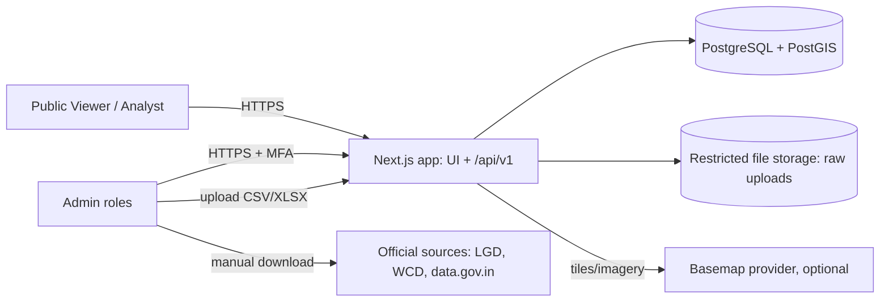

# System Architecture (SYSTEM_ARCHITECTURE)

## Context diagram

## Logical components
| Component | Responsibility | Boundary |
|---|---|---|
| Web UI (src/app, src/features) | Pages, map, panels, charts | Calls API only |
| API layer (src/app/api/v1) | Routing, validation, authorisation, envelope | Calls services |
| Services (src/server) | Business logic: geography, stats, schemes, imports, export | Calls repositories |
| Metrics (src/lib/metrics) | All formulas, suppression, reason codes | Pure functions |
| Repositories (src/server/db) | SQL and ORM queries | Only module touching DB |
| Import module (src/server/import) | Parse, validate, stage, publish, rollback | Restricted worker path |
| Auth (src/server/auth) | Sessions, MFA, role guard | Used by API layer |
| Shared (src/lib) | config, errors, logger, constants, formatters, schemas | Imported anywhere |

## Rendering strategy
Public pages: server-rendered shell with client map island. Data fetched via the API with caching. Admin: dynamic, no public caching.

## Data flow summary
1. Admin uploads file > import module validates > review > publish writes statistics rows.
2. Viewer opens map > boundaries endpoint > choropleth endpoint > panel endpoints on selection.
3. Rollups computed in SQL views by data_mode.

## Alternatives considered (full detail in ADRs)
| Alternative | Rejected because |
|---|---|
| Separate Node/NestJS backend | Extra deploy, duplicate types; Next.js route handlers suffice for the load; revisit if ETL or jobs outgrow it |
| Microservices | No independent scaling requirement |
| Redis cache | Not needed at pilot scale; HTTP caching and DB indexes first |
| Pre-generated PMTiles from day one | Added toolchain; reserved as upgrade path |
| Separate tables per admin level | More joins and duplicated stats FKs |

## Deployment view
Environments: local, staging, production. Production hosting TBD (OQ-06): government-approved hosting required for real sensitive deployments; managed Postgres with PostGIS needed. Demo on a general platform only with synthetic data.

## Scalability
Pilot dataset is small (hundreds of villages in Bhavnagar; roughly 18,000 or more villages statewide, figure to be verified). Statewide village geometry is the main size driver; handled by per-parent lazy loading and simplification.

## Quality attributes
Maintainability (single sources of truth), traceability (provenance), security (server-side RBAC), honesty (data modes).
