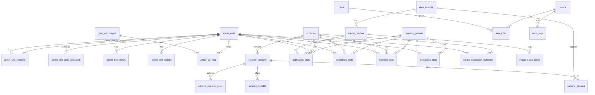

# Data Model (DATABASE_SCHEMA + ER_DIAGRAM)

PostgreSQL 15+ with PostGIS 3+ (versions to be re-verified at TASK-010). SQL types shown; the access layer is decided in ADR-0006. All tables use snake_case. All timestamps are timestamptz in UTC. Money is numeric(14,2) in INR. Counts are integer or bigint. Geometry SRID is 4326.

## Modelling decision
A generalised unit model was chosen over separate states/districts/talukas/villages tables (ADR-0003): `admin_units` holds the STABLE identity of a unit (level + LGD code) and `admin_unit_versions` holds what can change over time (parent, names, rural/urban class, status) with validity dates. Statistics always reference the stable `admin_units.id`, so a taluka that moves from one district to another keeps one continuous history (for example talukas moved to Vav-Tharad on 2 Oct 2025). Hierarchy for a period is resolved by joining the version valid at the period end date. Trade-offs: one FK target for all statistics, one search index, simple effective dating and re-parenting; cost is weaker per-level column typing, mitigated by CHECK constraints and a unique key (level, lgd_code, valid_from). Gram Panchayats are a separate table because the relationship to villages is many-to-one in time.

Statistics periods versus hierarchy: a statistic is stored against the stable unit id and the period; roll-ups walk the hierarchy version valid at the period end date, so Banaskantha figures before 2 Oct 2025 roll up to the old, larger district.

## ER diagram

## Enumerations
- admin_level: state, district, taluka, village
- rural_urban: rural, urban, unknown
- data_mode: VERIFIED, DEMO, ARCHIVED
- verification_status: unverified, verified_secondary, verified_official, rejected
- publish_status: draft, in_review, published, unpublished, superseded
- benefit_type: cash_recurring, cash_one_time, loan, subsidy, in_kind
- scheme_status: active, suspended, discontinued, renamed, merged, unverified
- batch_status: uploaded, validating, rejected, validated, in_review, approved, published, rolled_back
- access_class: A, B, C, D, E, F

## Provenance columns (every statistics table)
`source_id uuid NOT NULL FK data_sources`, `import_batch_id uuid FK import_batches`, `financial_year text NOT NULL` (pattern YYYY-YY), `period_id uuid NOT NULL FK reporting_periods`, `data_as_of date NOT NULL`, `uploaded_at timestamptz NOT NULL`, `verification_status verification_status NOT NULL`, `data_mode data_mode NOT NULL`, `publish_status publish_status NOT NULL DEFAULT 'draft'`, `publishing_authority text NULL`.
CHECK: data_mode = 'DEMO' rows must use a data_sources row flagged is_demo.

## Tables
### data_sources
id uuid PK; code text UNIQUE; name text; authority text; url text; format text; access_class access_class; licence_note text; update_interval text; is_demo boolean default false; last_checked_at timestamptz; notes text.

### import_batches
id PK; source_id FK; dataset_type text (lgd, boundaries, schemes, applications, beneficiaries, financial, population, eligible); file_name; file_sha256 char(64) UNIQUE per (dataset_type); status batch_status; data_mode; rows_total, rows_ok, rows_rejected int; created_by FK users; created_at; approved_by FK users NULL; approved_at; published_at; rolled_back_at; CHECK approved_by IS DISTINCT FROM created_by.

### import_batch_errors
id PK; batch_id FK; row_number int; field text; code text; message text.

### admin_units (stable identity)
id uuid PK; level admin_level NOT NULL; lgd_code text NOT NULL; census_code text NULL; created_at. UNIQUE (level, lgd_code). A unit is never deleted; a unit that ceases to exist gets a final version with valid_to and status 'abolished'. If LGD ever re-codes a unit, a new unit is created and linked through admin_unit_code_crosswalk (match_method official) so history can be bridged explicitly, not guessed.

### admin_unit_versions (what changes over time)
id uuid PK; unit_id FK admin_units; parent_unit_id FK admin_units NULL (NULL only for state); name_en text; name_gu text; rural_urban rural_urban default 'unknown'; status text (active, abolished, renamed); valid_from date NOT NULL; valid_to date NULL; source_id FK data_sources.
CHECK (valid_to IS NULL OR valid_to > valid_from). EXCLUDE USING gist (unit_id WITH =, daterange(valid_from, valid_to) WITH &&) so versions of one unit never overlap. Trigger: parent unit level must be exactly one above the child level; level 'state' iff parent_unit_id IS NULL. Indexes: (unit_id, valid_from), (parent_unit_id, valid_from), GIN trigram on name_en and name_gu (pg_trgm) plus an unaccent search column.
Helper view `v_units_as_of(date)` (or SQL function) returns the version valid on a date; every hierarchy query takes an as-of date (default today).

### admin_unit_aliases
id PK; unit_id FK admin_units; alias text; language char(2); kind (transliteration, former_name, local).

### gram_panchayats and village_gp_map
gram_panchayats: id PK; lgd_code text; name_en; name_gu; taluka_id FK admin_units; valid_from; valid_to. village_gp_map: village_id FK, gp_id FK, valid_from, valid_to; EXCLUDE overlapping periods per village.

### admin_boundaries
id PK; unit_id FK; geom geometry(MultiPolygon,4326) NOT NULL; geom_low geometry (ST_SimplifyPreserveTopology, state/district zoom); geom_mid geometry; area_km2 numeric; boundary_version text; source_id FK; verification_status; valid_from; valid_to; CHECK ST_IsValid(geom). Indexes: GiST on geom, geom_low, geom_mid; btree (unit_id, valid_from).

### schemes
id PK; code text UNIQUE (e.g. VAHALI_DIKRI); name_en; name_gu; department; target_group text[]; status scheme_status; replaced_by_id FK schemes NULL.

### scheme_versions
id PK; scheme_id FK; version_no int; effective_from date; effective_to date NULL; gr_reference text; gr_date date; objective_en/gu text; application_method text; official_url text; verification_status; verified_on date; UNIQUE (scheme_id, version_no); EXCLUDE overlapping effective ranges per scheme.

### scheme_eligibility_rules
id PK; scheme_version_id FK; rule_type (age_min, age_max, income_max, residence, marital_status, other); value_numeric; unit; text_en; text_gu; area_scope (rural, urban, all).

### scheme_benefits
id PK; scheme_version_id FK; benefit_type benefit_type; amount_inr numeric NULL; frequency text; stage_label text; in_kind_description text; in_kind_unit text.
Rule: loan, subsidy, cash and in-kind are separate rows; no column sums them.

### scheme_sources
scheme_version_id FK; source_id FK; url; retrieved_on date; verification_status.

### reporting_periods
id PK; financial_year text; period_type (fy, quarter, month, as_of); start_date; end_date; UNIQUE (period_type, start_date, end_date).

### population_stats
unit_id FK; reference_year int; total, male, female bigint NULL; rural_urban; provenance cols. UNIQUE (unit_id, reference_year, source_id, publish_status where published).

### eligible_population_estimates
scheme_id FK; unit_id FK; period_id FK; eligible_count bigint; method text NOT NULL; denominator_basis text NOT NULL (what population this counts); provenance cols.

### application_stats
scheme_id, scheme_version_id, unit_id, period_id FK; count_basis (period, cumulative) NOT NULL; received, approved, rejected, pending int NULL each; provenance. UNIQUE (scheme_id, scheme_version_id, unit_id, period_id, count_basis, data_mode, import_batch_id). CHECK: approved+rejected+pending <= received when all non-null (violations logged to data-quality, not silently fixed).

### beneficiary_stats
scheme_id, scheme_version_id, unit_id, period_id FK; count_basis (period, cumulative) NOT NULL; active_count, ever_approved_count, unique_paid_count int NULL; suppressed boolean; provenance. UNIQUE (scheme_id, scheme_version_id, unit_id, period_id, count_basis, data_mode, import_batch_id).

### financial_stats
scheme_id, scheme_version_id, unit_id, period_id FK; count_basis (period, cumulative) NOT NULL; benefit_type; allocated_inr, sanctioned_inr, disbursed_inr numeric NULL; in_kind_units int NULL; in_kind_unit_label text; provenance. UNIQUE adds benefit_type.

### users, roles, user_roles
users: id PK; email citext UNIQUE; name; password_hash or external subject (per ADR-0005); mfa_enabled boolean; is_active; last_login_at. roles: id; code (public_viewer, analyst, data_manager, department_reviewer, super_admin). user_roles: user_id, role_id, scope_unit_id NULL (optional district scope), granted_by, granted_at.

### audit_logs
id bigserial PK; at timestamptz; actor_id FK users NULL; action text; entity_type; entity_id; request_id; before_summary jsonb; after_summary jsonb; ip_hash text. The application database role is granted INSERT and SELECT only. No UPDATE or DELETE grants.

## Views (read models)
`v_village_scheme_latest`, `v_taluka_rollup`, `v_district_rollup`, `v_state_rollup` aggregate published rows by data_mode. Rollups use only published rows, never mix modes, and carry min(data_as_of) and the count of reporting child units. Rollup with missing children returns coverage_of_children so a total is never presented as complete.

## Index strategy
GiST on geometries; btree on every FK; composite (scheme_id, unit_id, period_id) on stats tables; partial indexes on publish_status = 'published'; trigram on names.

## Retention
Raw uploaded files: 12 months in restricted storage (provisional). Audit logs: 7 years (provisional, confirm legal need). Published statistics: retained; superseded rows kept for history.

## Synthetic example (DEMO only)
| table | row |
|---|---|
| data_sources | code DEMO_SEED_V1, is_demo true |
| application_stats | scheme VAHALI_DIKRI, unit (a Bhavnagar village LGD code), FY 2025-26, received 40, approved 31, rejected 3, pending 6, data_mode DEMO, verification_status unverified |
These figures are invented to exercise the system. They must never be copied into a VERIFIED dataset.

## Additions v0.2.0
### admin_unit_code_crosswalk
id PK; unit_id FK admin_units; code_system text (lgd, census2011, other); code text; valid_from; valid_to; match_method (official, name_parent_reviewed); reviewed_by FK users; reviewed_at. UNIQUE (code_system, code, valid_from). Imports keyed by census codes resolve through this table only (FR-ADM-09).
### Geographic completeness fields in rollup views (FR-DAT-08)
Every rollup view returns: units_expected (count of active child units in the hierarchy), units_with_boundary, units_reporting (child units having at least one published row for the metric and period), and coverage_label (Complete, Partial, None). The API passes these in meta.coverage so the UI can say, for example, 1 of 34 districts loaded.
### issues (FR-UX-07)
id PK; unit_id FK NULL; scheme_id FK NULL; metric text; period_id FK NULL; message text (max 1000, sanitised); contact text NULL (optional, user typed); status (open, triaged, resolved, rejected); request_id; created_at; handled_by FK users NULL; handled_at. Contact is purged when the issue is resolved (retention 90 days).
### scheme_target_groups
scheme_id FK; target_group text (girl_child, married_women, widows, pregnant_lactating_mothers, women_entrepreneurs, working_women); PRIMARY KEY (scheme_id, target_group). Replaces the free text array on schemes for filter queries (schemes.target_group array remains only as a cache or is dropped at TASK-021).

## Rule: count_basis
Every count column states whether it is for the period (flow) or cumulative (stock). Metrics refuse to mix bases (reason code BASIS_MISMATCH). Importers require the basis column.

## Column added v0.3.0
`version_spans_period boolean NOT NULL DEFAULT false` on application_stats, beneficiary_stats and financial_stats (see import-pipeline.md, logic rule 1).
