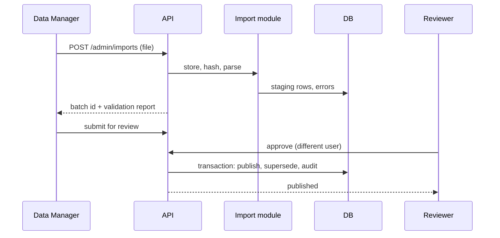

# System Flows

## <a id="drilldown"></a>Drill-down (State > District > Taluka > Village)
```mermaid
stateDiagram-v2
  [*] --> State
  State --> District: select district
  District --> Taluka: select taluka
  Taluka --> Village: select village
  Village --> Taluka: back
  Taluka --> District: back
  District --> State: back
```
State machine (hook useMapDrilldown) holds: level, selected lgd codes, financial year, scheme, metric. URL is the source of truth; changes push history entries so the browser Back button works.
Steps for select district: 1) set state, 2) fetch child boundaries (cached by parent code + version), 3) fitBounds animation, 4) breadcrumb update, 5) fetch choropleth values for children, 6) panel loads district stats. Failures at 2 or 5 leave the previous level intact and show a retry.

## <a id="deep-links"></a>Deep links
Query params: unit (lgd code), level, scheme, fy, metric, lang, asof (optional). Invalid params are ignored with a notice, never crash.

## Search
Input > debounce 250 ms > GET /geo/search > results with level, parent chain, LGD code > select > state machine jumps directly to the level and fits bounds.

## Import and publish


## Rollback
Reviewer or Super Admin calls rollback > transaction reverses publish > audit > cache invalidation.

## Statistics read
Request > validate query (Zod) > authorise (public) > service > SQL rollup by data_mode > metrics module computes rates > envelope with meta > response.

## Error flow
Any thrown AppError > central handler > log with requestId > safe JSON body > UI shows message and requestId.

## Language switch
Locale in URL path or cookie; catalogs loaded server-side; chart labels and map tooltips read the same catalog.
